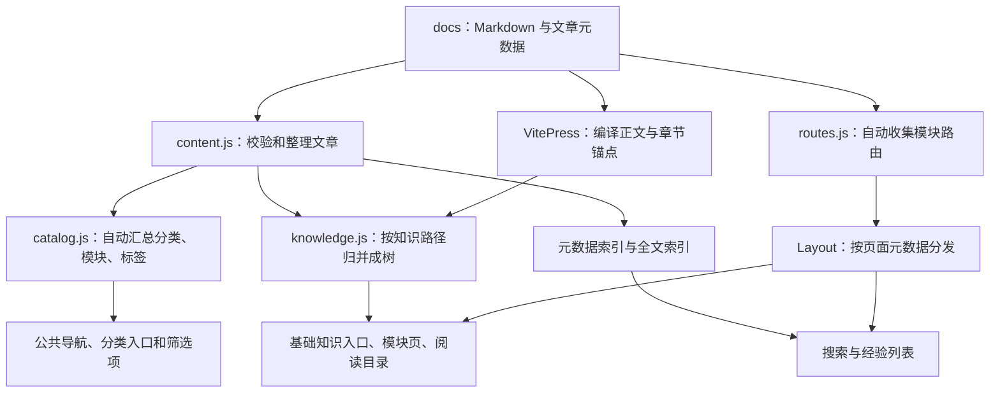
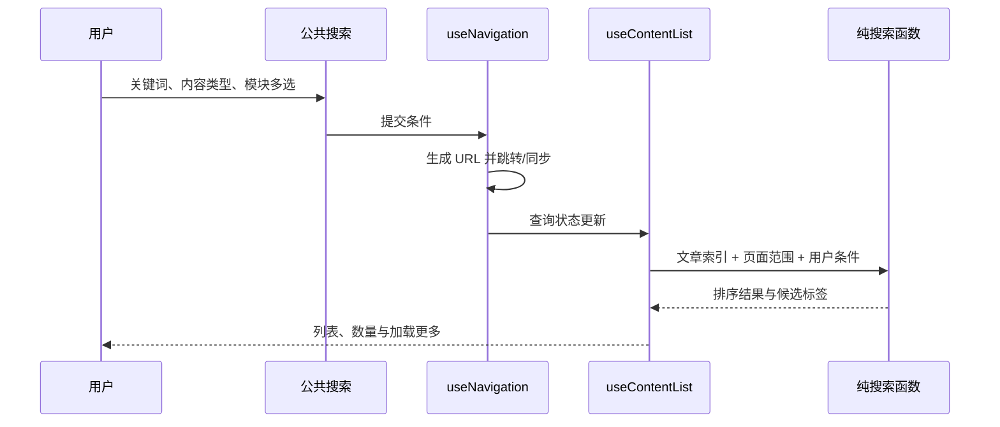

# 项目架构与功能说明

项目使用 VitePress + Vue 3，将 Markdown 构建为静态站点。基础知识按树组织，经验分享按列表展示，搜索在浏览器本地完成。没有后台数据库，也没有额外引入 Vue Router 或 Pinia。

## 一、架构思路

核心原则是：**内容与分类写在文章中，页面从文章生成。** 不再维护独立的 categories、标签词表、learningStages 或 knowledgePaths 清单。网站固有的两种内容类型仍保留在 `content.config.js`。

知识树的层次为：领域 → 模块 → `knowledge` 路径 → 文章 → Markdown 子章节。相同路径自动合并，`order` 决定顺序。标签是另一条检索维度，不承担知识点的父子关系。

详细写法见 [基础知识维护说明](<D:/Code Files/zjr/Blog/KNOWLEDGE.md>)。

## 二、文件职责

### 配置、构建与数据

| 文件                                  | 作用                                                                        |
| ------------------------------------- | --------------------------------------------------------------------------- |
| `package.json`                        | npm 脚本和依赖声明                                                          |
| `package-lock.json`                   | 锁定依赖版本                                                                |
| `.vitepress/config.mjs`               | 站点语言、标题、srcDir、base、Markdown 和主题设置；模块页标题从路径参数读取 |
| `.vitepress/content.config.js`        | 仅保留基础知识、经验两种内容类型和模块 URL 规则                             |
| `.vitepress/data/content.js`          | 统一校验 frontmatter，生成文章对象，过滤结构页与草稿                        |
| `.vitepress/data/articles.data.js`    | 收集基础知识与经验的轻量文章元数据                                          |
| `.vitepress/data/search.data.js`      | 收集包含正文文本的全文索引                                                  |
| `.vitepress/data/catalog.js`          | 自动汇总领域、分组、模块和标签，检查同模块的归属冲突                        |
| `.vitepress/data/knowledge.data.js`   | 使用站点 Markdown 渲染器提取真实标题锚点，生成知识树数据                    |
| `.vitepress/data/knowledge.js`        | 合并知识路径、生成章节节点、提取阅读顺序                                    |
| `.vitepress/data/routes.js`           | 在 VitePress 初始化路由时扫描文章，自动生成模块参数                         |
| `.vitepress/data/search.js`           | 与 Vue 无关的搜索、筛选、排序及 URL 转换函数                                |
| `.github/workflows/deploy.yml`        | GitHub Actions 安装依赖、构建并发布到 GitHub Pages                          |
| `.prettierrc.json`、`.prettierignore` | 格式化规则与排除项                                                          |
| `.gitignore`                          | 排除依赖、缓存、构建产物等                                                  |
| `.vitepress/cache/`                   | 自动生成的开发缓存与临时验证文件，不是内容源                                |
| `.vitepress/dist/`                    | 可发布的静态站点产物                                                        |
| `node_modules/`                       | npm 依赖                                                                    |
| `.idea/`                              | IDE 配置，不参与网站运行                                                    |
| `AGENTS.md`                           | 项目协作规范                                                                |
| `README.md`                           | 项目使用说明，实际行为以源码和当前维护说明为准                              |

路由生成早于 `createContentLoader` 初始化，因此 `routes.js` 直接扫描 Markdown，并复用 VitePress 的 frontmatter 解析与公共文章转换函数；不使用另一套手写 YAML 解析器。

### 内容页面与 URL

| 文件                            | 对应页面                                                         |
| ------------------------------- | ---------------------------------------------------------------- |
| `docs/index.md`                 | 首页 `/`，`pageKind: home`                                       |
| `docs/search.md`                | 全站搜索 `/search.html`                                          |
| `docs/basics/index.md`          | 基础知识入口 `/basics/`                                          |
| `docs/basics/search.md`         | 基础知识搜索 `/basics/search.html`                               |
| `docs/basics/[module].md`       | 模块页模板，例如 `/basics/php.html`                              |
| `docs/basics/[module].paths.js` | 调用 `modulePaths()`，为已有文章模块生成路由参数                 |
| `docs/experience/index.md`      | 经验入口 `/experience/`                                          |
| `docs/experience/search.md`     | 经验搜索 `/experience/search.html`                               |
| 新增的文章 Markdown             | URL 来自文件路径，业务分类来自 frontmatter 的 type/module 等字段 |

经验不需要独立模块模板，模块查询进入经验搜索页。文章不设置 `pageKind`；否则会被视为结构页而排除在文章索引之外。

### 主题与页面

以下路径以 `.vitepress/theme/` 为起点。

| 文件                                        | 作用                                                                |
| ------------------------------------------- | ------------------------------------------------------------------- |
| `index.js`                                  | 扩展默认主题，注册自定义 Layout 和样式                              |
| `Layout.vue`                                | 公共头部、正文、页脚；根据 pageKind/type 分发页面，建立导航共享状态 |
| `content.js`                                | 将文章索引转换成前端共用的自动目录，提供 label/findModule 等查询    |
| `pages/HomePage.vue`                        | 首页介绍、自动模块入口、经验列表和标签                              |
| `pages/GlobalSearchPage.vue`                | 不限制内容类型的搜索页                                              |
| `pages/basics/BasicsIndexPage.vue`          | 按领域展示模块，可展开知识结构；无文章时展示空状态                  |
| `pages/basics/BasicsModulePage.vue`         | 模块完整知识树、模块搜索及经验入口                                  |
| `pages/basics/BasicsSearchPage.vue`         | 固定基础知识类型的搜索列表                                          |
| `pages/basics/BasicsDetailPage.vue`         | 以知识树替换阅读导航，提供上一主题/下一主题                         |
| `pages/experience/ExperienceIndexPage.vue`  | 经验入口与通用文章列表                                              |
| `pages/experience/ExperienceSearchPage.vue` | 固定经验类型的搜索列表                                              |
| `pages/experience/ExperienceDetailPage.vue` | 组合公共阅读器                                                      |

基础知识入口与模块页不再展示普通文章列表；搜索页仍使用列表，因为检索结果适合快速扫描。业务页面保留独立文件，方便将来分别定制。

### 公共组件

| `components/` 下的文件  | 作用                                                                              |
| ----------------------- | --------------------------------------------------------------------------------- |
| `AppHeader.vue`         | 导航、移动菜单、深浅色切换、公共搜索弹窗                                          |
| `AppFooter.vue`         | 公共页脚                                                                          |
| `HomeHero.vue`          | 首页介绍与主要入口                                                                |
| `CategoryGrid.vue`      | 从自动分类目录展示模块链接，空内容时显示提示                                      |
| `KnowledgeTree.vue`     | 递归树、分支展开、文章与章节链接，自动展开当前阅读分支                            |
| `KnowledgePath.vue`     | 模块知识树分区布局和空状态                                                        |
| `SearchForm.vue`        | 输入关键词、提交、对父组件暴露 focus 方法                                         |
| `AppSelect.vue`         | 自定义单选弹层，支持方向键、Enter、Escape 等键盘操作                              |
| `ModuleScopePicker.vue` | 自动模块多选，支持全选与清空                                                      |
| `FilterPanel.vue`       | 类型、领域、分组、模块、标签筛选                                                  |
| `ContentList.vue`       | 组合搜索、筛选、结果摘要、重试和分批加载                                          |
| `ArticleList.vue`       | 只负责渲染给定的文章列表与空状态                                                  |
| `ArticleReader.vue`     | 正文、目录、标签和阅读布局；sidebar/before-content/after-content 插槽支持页面定制 |

### 样式与状态

| 文件                            | 作用                                         |
| ------------------------------- | -------------------------------------------- |
| `style.css`                     | 公共 CSS 导入入口                            |
| `styles/tokens.css`             | 字体、品牌色、深浅模式、边框和圆角变量       |
| `styles/base.css`               | 基础控件、焦点、正文和代码等共享样式         |
| `styles/layout.css`             | 页面容器、标题、面包屑和通用响应式规则       |
| `styles/forms.css`              | 公共表单与下拉选择器样式                     |
| 各组件的 scoped CSS             | 局部布局与手机端调整                         |
| `composables/useNavigation.js`  | URL 查询状态、页面搜索上下文和路由同步       |
| `composables/useContentList.js` | 索引加载、筛选结果、候选标签、分页与失败状态 |
| `utils/navigation.js`           | 判断内容类型、搜索路径与当前页面默认范围     |
| `utils/search.js`               | 给纯搜索函数注入自动目录，保留组件使用接口   |

## 三、主要函数与方法

| 所在文件                 | 函数/成员                                         | 功能                                                  |
| ------------------------ | ------------------------------------------------- | ----------------------------------------------------- |
| `config.mjs`             | `transformPageData`                               | 动态模块页使用参数中的显示标题                        |
| `content.config.js`      | `moduleUrl`                                       | 模块 ID 转为基础知识模块 URL                          |
| `data/content.js`        | `stringList`                                      | 校验标签、知识路径等字段是非空字符串数组              |
| 同上                     | `toArticle`                                       | 校验并规范化一篇文章；可选提取正文文本                |
| 同上                     | `transformArticles`                               | 过滤结构页和草稿，转换文章并按 order/URL 排序         |
| `data/catalog.js`        | `createCatalog`                                   | 合并模块、领域、分组、标签，并提供名称/模块查询       |
| `data/routes.js`         | `modulePaths`、内部 `scan`                        | 扫描两类 Markdown，以文章目录生成模块路由             |
| `data/knowledge.js`      | `headingNodes`                                    | 将 VitePress 标题层级转换为可点击的章节树             |
| 同上                     | `buildKnowledge`                                  | 根据主模块和 knowledge 数组归并树分支，接入文章与章节 |
| 同上                     | `chapterLinks`                                    | 深度优先提取文章阅读顺序，不把章节锚点当成独立文章    |
| `data/knowledge.data.js` | `transform`                                       | 读取文章正文，使用相同渲染器取得 headers，再生成树    |
| `data/search.js`         | `emptySearch`                                     | 返回新的空条件对象                                    |
| 同上                     | `selectedModules`                                 | 将单选与多选模块统一为去重数组                        |
| 同上                     | `parseSearch`                                     | 查询串转为搜索状态，用自动目录校验模块/领域           |
| 同上                     | `searchQuery`                                     | 状态转查询串，支持重复 module/tag 参数                |
| 同上                     | `changeFilter`                                    | 更新筛选并清理失效的下级条件                          |
| 同上                     | `nearWord`、`score`                               | 英文单次编辑容错和关键词相关度评分                    |
| 同上                     | `matchesModules`                                  | 仅匹配主模块，不使用关联模块扩展分类                  |
| 同上                     | `searchArticles`                                  | 先筛选范围与标签，再按关键词评分排序                  |
| 同上                     | `collectTags`                                     | 当前范围候选标签并集及数量，统计时忽略已选标签        |
| `utils/navigation.js`    | `pageContentType`                                 | 从页面元数据判断基础知识或经验                        |
| 同上                     | `searchPath`                                      | 返回类型专属或全站搜索地址                            |
| 同上                     | `resolveSearchContext`                            | 从文章、路由参数和查询条件确定默认模块范围            |
| `useNavigation.js`       | `provideNavigation`、`useNavigation`              | 通过 provide/inject 建立与读取共享状态                |
| 同上                     | `sync`、`search`                                  | 同步浏览器查询串；同页 pushState，跨页 router.go      |
| 同上                     | 挂载/卸载                                         | 监听并清理路由变化和 popstate，保留原路由钩子         |
| `useContentList.js`      | `state/candidates/results/visible/selected`       | 计算有效条件、标签、完整结果、当前条目和摘要          |
| 同上                     | `loadIndex`                                       | 客户端加载全文索引，失败时支持重试                    |
| 同上                     | `update/reset`                                    | 修改或清空查询，提交到对应搜索页                      |
| `AppHeader.vue`          | `openSearch/closeSearch/closed`                   | 初始化范围、打开/关闭 dialog、恢复滚动和焦点          |
| 同上                     | `submit/updateModules`                            | 校验模块选择并提交，更新范围与错误提示                |
| 同上                     | `keyboard/clickBackdrop`                          | 处理快捷键与背景点击关闭                              |
| `AppSelect.vue`          | `open/choose/keydown/outside/blur`                | 控制展开、选中、键盘导航和失焦收起                    |
| `SearchForm.vue`         | `focus`、提交事件、watch                          | 聚焦、提交修剪后的关键词、同步外部查询                |
| `ModuleScopePicker.vue`  | `toggle`                                          | 发出添加/移除模块后的新数组                           |
| `FilterPanel.vue`        | `rows/visibleTags`                                | 派生筛选行；保留无结果的已选标签供取消                |
| 同上                     | `removeModule/toggleTag`                          | 发出修改后的筛选条件                                  |
| `KnowledgeTree.vue`      | `containsCurrent`                                 | 检查节点是否包含当前文章，展开其祖先分支              |
| `BasicsDetailPage.vue`   | `tree/currentUrl/chapters/position/previous/next` | 计算当前知识树与前后阅读链接                          |
| `ArticleReader.vue`      | `siblings/headers/moduleHref` 等                  | 默认同模块目录、正文目录和模块入口链接                |

纯展示组件没有额外业务方法。模板中的 button、details 和链接只负责触发操作或展示，不另建无意义的包装函数。

## 四、搜索如何工作

- 模块多选是 OR，多个标签与空格分隔关键词是 AND。
- 分类只按文章主模块，关联技术不会让 HTML 文章进入 JavaScript 分类。
- 关键词评分：标题 12、摘要/标签/模块标识 6、正文 2、近似英文 1。
- 至少 4 个字母的英文词允许一次插入、删除或替换；中文是子串匹配。
- 每次显示 12 条，筛选变化后重置；URL 可以分享和恢复。
- 正文索引在 ContentList 挂载后加载；基础知识的目录树不依赖全文索引。
- 没有文章时模块选择为空，仍允许提交全站搜索并展示空结果。

## 五、最终功能与维护方式

| 需求                 | 当前实现                                                       |
| -------------------- | -------------------------------------------------------------- |
| 添加新技术模块       | 新文章填写 module，自动生成模块入口                            |
| 给知识建立父子结构   | 文章填写 knowledge 数组，正文使用章节标题                      |
| 调整学习顺序         | 修改文章 order，无需编辑路径清单                               |
| 增加标签             | 直接填写 tags，候选标签自动统计                                |
| 读文章时保持知识位置 | 阅读侧栏复用同一棵树，当前主题展开，提供前后主题               |
| 只定制经验页         | 修改对应 experience 页面；公共阅读器有插槽                     |
| 手机端与深色模式     | 公共设计变量 + 组件媒体查询 + 原生 details 折叠                |
| 静态部署             | build 输出 dist，经 GitHub Pages 托管；withBase 处理部署子路径 |

当前没有文章时展示空状态，不保留预设文章主题。draft 只控制索引，不代表页面访问权限。

## 六、验证

- `npm test`：自动分类、知识树合并/排序、章节锚点、动态模块路径、模块筛选与标签统计。
- `npm run build`：Markdown、Vue、静态链接与预渲染。
- `npm run preview`：预览构建产物，检查手机布局、主题切换、目录和搜索。
- 格式检查优先只针对修改文件。

测试数据使用内存或临时目录，不恢复用户删除的正文。`check:build` 脚本仍指向尚未提供的独立文件，不作为当前验证入口。
