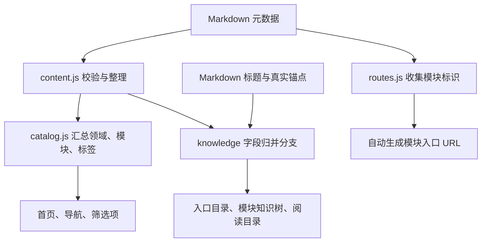

# 基础知识树：只维护文章

基础知识使用“模块 → 知识路径 → 文章 → 正文章节”的树形结构。经验分享继续使用列表，两个类型都支持搜索和标签。

不再维护 `categories`、标签词表、`learningStages` 或 `knowledgePaths` 配置。分类、模块入口、分支、标签以及学习顺序，全部来自已发布文章。

## 一篇文章的写法

下面是格式说明，不会自动创建示例文章：

```markdown
---
title: 数组的基本概念
description: 说明数组的结构与基本用法。
type: basics
module: php
moduleName: PHP
area: 后端
knowledge: [语言基础, 数据类型]
tags: [数组, 基础语法]
order: 10
---

# 数组的基本概念

## 什么是数组

正文。

### 键与值

更细的知识点。
```

自动得到：

```text
后端
└─ PHP
   └─ 语言基础
      └─ 数据类型
         └─ 数组的基本概念
            └─ 什么是数组
               └─ 键与值
```

同一模块的文章填写相同的 `knowledge` 前缀，会自动合并到同一个分支下。路径长度不限；不填时文章直接位于模块下面。

| 字段                   | 如何维护                                                         |
| ---------------------- | ---------------------------------------------------------------- |
| `title`、`description` | 文章标题和摘要，必填                                             |
| `type`                 | 基础知识填 `basics`，经验填 `experience`                         |
| `module`               | 稳定模块标识，必填；使用小写字母、数字、下划线或连字符，如 `php` |
| `moduleName`           | 可选显示名称；同模块至少一篇填写即可，未填写时使用模块标识       |
| `area`                 | 可选领域名称，如 `后端`；省略为“未分类”，同模块文章保持一致      |
| `group`                | 可选技术分组，如“操作系统”；一般无需填写，同模块文章保持一致     |
| `knowledge`            | 可选知识路径数组，按从宽到细填写，只决定知识树分支               |
| `tags`                 | 可选标签数组，自由填写，不需要注册；相同文字视为同一标签         |
| `order`                | 可选学习顺序，越小越靠前，默认 0；同分按 URL 排序                |
| `draft`                | 从目录和索引中排除；不阻止 VitePress 生成 Markdown 页面          |

`knowledge` 表达父子关系，`tags` 用于跨分支查找，两者不用重复填写。章节继续用 Markdown 的 `##` 至 `######`；代码块中的标题不会成为知识点。

一个模块的 `area/group` 必须一致，显式填写的 `moduleName` 也必须一致；冲突会报错，避免同一模块被归入多个领域。文章分类只认 `module`，不会因为 `relatedModules` 关联信息出现在其他模块下。

## 自动生成链路



| 文件                                            | 职责                                                  |
| ----------------------------------------------- | ----------------------------------------------------- |
| `.vitepress/content.config.js`                  | 仅保留两种内容类型和模块 URL 规则                     |
| `.vitepress/data/content.js`                    | 校验元数据、过滤结构页和草稿、提供文章索引结构        |
| `.vitepress/data/catalog.js`                    | 从文章汇总分类、模块、标签，并检查模块归属冲突        |
| `.vitepress/data/routes.js`                     | 在路由生成阶段收集模块，供 `[module].paths.js` 使用   |
| `.vitepress/data/knowledge.js`                  | 按 `knowledge` 合并树，追加章节节点，提取前后阅读顺序 |
| `.vitepress/data/knowledge.data.js`             | 用 VitePress 渲染器提取标题和准确锚点，输出知识树     |
| `.vitepress/theme/content.js`                   | 给页面提供统一的自动分类数据与名称查询                |
| `.vitepress/theme/components/KnowledgeTree.vue` | 可展开的递归树，入口和阅读页共用                      |
| `.vitepress/theme/components/KnowledgePath.vue` | 模块完整知识树和空状态                                |

修改文章即可更新目录。新增或删除模块后，生产构建会重新生成模块路由；开发服务器若未即时识别新模块，可重启 `npm run dev`。

没有文章时，不生成虚构模块、主题或链接，入口展示空状态。可独立调试页面外壳；需要检查树的层级样式时，可由你添加最少量的测试内容。

验证命令：`npm test`、`npm run build`。测试样例仅在内存或系统临时目录中，不会向项目 `docs` 添加文章。
